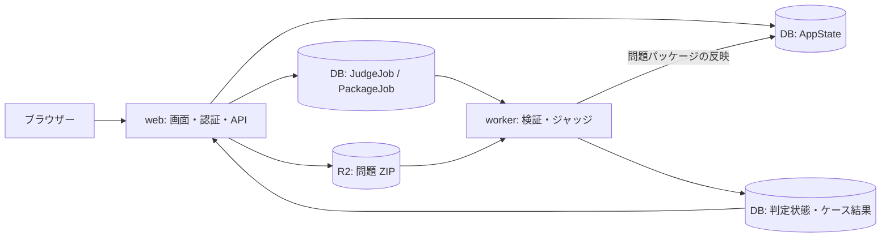

# OJP の現在の仕様と改善案

確認日: 2026-10-05

2026-10-06の実装進捗は末尾の第13節、2026-10-09のLinux検証結果は第14節、本番workerの隔離前提条件は第15節に追記しています。以下の監査時点の課題と、実装済み・検証待ちの項目を区別してください。

リポジトリのコード、README、`atcoder_like_platform_spec_draft.md` を照合した記録です。現在のコードを基準とし、元の仕様書に書かれているだけの機能は実装済みとして扱いません。本番の設定値、負荷限界、障害の再現、バックアップの実在は今回の確認対象外です。

## 1. サービスと技術構成

問題を作成・公開し、コードを提出して自動採点し、コンテストを開催できるオンラインジャッジです。学習・小規模コンテスト向けの機能は一通り実装されています。データ保存と提出コードの実行隔離には、下記の改善が必要です。

| 項目 | 現在の構成 |
| --- | --- |
| Web / API | Next.js 16.3.8 の App Router / Route Handlers |
| UI | React 19.2.3、TypeScript、CodeMirror |
| 認証 | Auth.js / NextAuth、GitHub と Google |
| DB | PostgreSQL、Prisma 6 系 |
| 問題パッケージ | Cloudflare R2、S3 互換 API |
| 非同期キュー | PostgreSQL の `JudgeJob` / `PackageJob` |
| 配備 | Dockerfile と heroku.yml による Heroku Container |
| 実行環境 | Node.js 24 系、g++、Python 3、Java、GNU time |

元の仕様書で提案されていた Redis は、現在の実装では使用していません。



## 2. アカウントと権限

- GitHub / Google の OAuth でログインします。メール・パスワード認証、異なるプロバイダーのアカウントを利用者が連携する画面はありません。
- ロールは `guest`、`user`、`problem_author`、`contest_organizer`、`admin` です。
- 通常ユーザーは提出・参加・プロフィール編集ができます。
- 問題作成には `problem_author` または `admin`、コンテスト作成には `contest_organizer` または `admin` が必要です。新規ログインだけで両方の作成権限が付く仕様ではありません。
- 管理者がロールを変更できます。GitHub のログイン名・IDによる管理者付与設定もあります。
- アカウントには `active`、`frozen`、`deleted` の状態があります。管理画面では凍結・解除を操作できます。
- プロフィールで Display Name と Bio を編集できます。表示名変更は30日ごとで、大文字・小文字を区別しない重複チェックと変更監査ログがあります。
- 問題の Author、提出者、順位表、ダッシュボード、管理画面のユーザー一覧は現在の Display Name を参照します。ヘッダーの `@ログイン名` は OAuth のログイン情報です。
- 所有権・提出者・成績の関連付けにはユーザーIDを使います。表示名変更で関連付けは変わりません。

## 3. 問題の作成・編集・閲覧

問題にはタイトル、slug、問題文、入力・出力の説明、制約、解説、公開設定、難易度、実行時間・メモリ制限、テスト結果の公開粒度などを設定します。

- 公開範囲は `public`、`unlisted`、`private`。限定公開は一覧に出さずURLで閲覧でき、非公開は作成者・管理者向けです。
- 難易度は手動設定の整数または未設定です。AtCoder系の数値・色表示を使いますが、難易度の自動推定や利用者のレーティング計算はありません。
- 問題文・制約・解説などは Markdown、表、箇条書き、コードブロック、KaTeX の数式に対応します。
- エディターには構文色分けとライブプレビューがあります。
- 作成・編集画面は「問題文など」「問題の設定など」「テストケース」「テスト run」の4タブです。
- ZIP のインポートでフォームを自動入力できます。サンプル説明、グループ、部分点、checker、各ケースも編集できます。
- 既存問題は最初にケース一覧を読み込み、選択したケース本文だけをオンデマンドで読み込みます。
- 編集画面から現在の内容を ZIP に書き出せます。既存問題も対象です。
- 保存前に解答コードを実行し、設定中のテストと checker で確認できます。
- サンプルごとに説明を設定でき、問題ページでは入出力欄の下に表示します。
- 問題ページ下部にも提出欄があります。解説は別ページで、公開時期は常時・関連コンテスト終了後・非公開から選びます。
- 自分が正解した問題は、問題一覧で行全体を薄い緑にします。

「対応言語一覧」は問題画面から取り除かれていますが、提出言語の選択・履歴表示はあります。

## 4. ZIP と採点設定

基本構成は次のとおりです。問題文等を `statement.md`、制限や公開設定・グループ等を `config.json`、各ケースを `.in` / `.out` で表現します。

```text
problem.zip
  statement.md
  config.json
  samples/sample1.in
  samples/sample1.out
  tests/group1/case01.in
  tests/group1/case01.out
  checker/Main.py              # special judge の場合
```

- グループは名前だけ、または名前と部分点を持つ形式です。
- 部分点ありでは全グループに配点を設定し、合計を100点にします。そのグループの全ケースがACなら配点を獲得します。
- 部分点なしでは全ケースACで100点、それ以外は0点です。
- 部分点あり・なしのグループ混在は拒否します。
- テスト名は省略するとファイルから検出されます。
- 通常比較は `exact` または `ignore_trailing_spaces`。後者は行末の空白・タブと末尾の空行を無視します。
- special judge は C++ / Python / Java / JavaScript の4言語です。任意の追加言語に自動対応する機能ではありません。
- checker に入力・正解出力・提出出力のファイルパスを渡し、終了コード0をAC、1をWA、それ以外をIEとします。checkerのタイムアウトは10秒です。
- special judge でも、現在のバリデーションでは `.in` / `.out` のペアが必要です。
- ZIP テンプレートを作る `npm run template:problem-zip` があります。

サーバー側の主な上限は以下です。MiB は `1024 * 1024` バイトです。

| 対象 | 上限 |
| --- | --- |
| ZIP 本体 | 256 MiB |
| 個別ファイルの展開サイズ | 32 MiB |
| 全ファイルの展開サイズ | 512 MiB |
| ファイル数 | 4,000 |

危険なパスとサイズ超過を検証します。ただし、この上限以下であれば常に高速・省メモリで処理できるという性能保証ではありません。

## 5. 提出とジャッジ

- 提出言語は C++17、Python 3、Java、JavaScript (Node.js)、Brainfuckです。
- CodeMirror のコードエディター、言語別テンプレート、構文色分けがあります。
- C++ / Java はコンパイルし、Python は `py_compile`、JavaScript は `node --check`、Brainfuckは角括弧の対応を事前チェックします。
- `pending -> queued -> compiling -> running -> judging` を経て、AC / WA / TLE / MLE / RE / CE / IE などに確定します。
- package のない問題への提出はIEになります。
- 通常提出は同じ利用者・問題で10秒のクールダウン、利用者ごとに1分20件の制限があります。管理者は制限を回避します。
- ジャッジはテストを順番に実行します。入力・正解出力はケースごとにファイル化し、提出の標準出力はファイルに書き、比較もファイル経由です。
- 全体・通常のグループ表示の時間はケースの最大値、メモリは最大値を使います。ただし、他人向け `group_only` の集計に時間の合計値を使う経路が残っています。
- 時間は整数msで表示します。測定値は実経過時間とGNU timeのCPU時間から条件で選択するため、「すべて厳密に1ms精度の実経過時間」ではありません。
- GNU time が使える場合に最大RSSを取得します。メモリ超過判定は実行終了後の測定値との比較です。
- 未完了ケースをWJとして表示し、ジャッジ中は2秒ごとの画面更新で完了済み結果を反映します。WebSocket / SSE のプッシュ配信ではありません。
- 結果はグループでまとめ、展開すると個別ケースを見られます。
- 他人のソースコードは表示せず、本人・管理者だけが閲覧できます。ケース情報は `group_only` / `case_index_only` / `case_name_visible` の設定で制限します。
- 問題作成者・関連コンテスト主催者・管理者は再ジャッジを要求できます。通常利用者の提出者本人というだけでは再ジャッジ権限は付きません。
- 再ジャッジは利用者ごとに1分3件、同じ利用者・問題で60秒のクールダウンがあります。管理者は制限を回避します。
- 提出には `judgeEnvironmentVersion` を記録します。問題パッケージの固定バージョンを提出に紐付ける仕組みはありません。

## 6. コンテスト

- タイトル、説明、公開範囲、開始・終了時刻、ペナルティ、順位表公開設定、問題セット、ラベル、整数配点、順序、Ratedを編集できます。日時入力は日本時間です。開始後は開催期間・問題セット・配点・ペナルティ・Ratedを固定します。
- 状態は現在時刻で `scheduled` / `running` / `ended` と判定します。
- 開催前のコンテスト提出は拒否します。開催中の提出は問題セット所属を確認し、未参加者なら自動で参加登録します。
- 終了後は通常の練習提出として扱い、コンテスト順位表には入れません。
- 順位表は開催中の正式提出の確定結果を対象に、問題の0〜100点を設定配点に換算して最高点を合計します。500点の問題で部分点50なら250点です。得点・ペナルティ・最終最高点到達時刻で順位を決め、同条件は同順位とします。
- ペナルティは正の最高点到達時の経過分と、満点到達時に限ってその前の失敗提出数に応じて加算します。CE・IE・取消は失敗回数に含めません。
- 順位表公開は `hidden` / `partial` / `full`。hiddenは終了後公開です。
- 表示中は5秒ごとに順位表APIから差分用データを再取得します。非表示タブでは停止します。プロセス内の判定取得・派生ratingキャッシュを使いますが、順位表の専用永続化テーブルはありません。
- privateは主催者・管理者のみ、unlistedは直接リンクから閲覧・参加できます。join・submit・問題閲覧でも同じ権限を確認します。
- 終了後は1人1回のバーチャル参加を開始でき、個人タイマーを専用DBに保存します。正式順位表・ratingには影響しません。
- 公開Ratedコンテストは対象者2人以上で独自Eloを計算します（初期1500、K=32）。主催者・出題者・バーチャル・参加登録だけの人は対象外です。再ジャッジ時は終了時刻順に履歴を再計算します。既存のRated未設定イベントはUnratedです。

正確な規則・導入・専用環境での通しテストは [コンテスト仕様](contests.md) を参照してください。

## 7. プロフィールと管理

プロフィールには正解問題数、提出数、AC数・率、最高点合計、平均点・時間、最大メモリ、練習・コンテスト提出数、参加・主催コンテスト数、作成問題数、初回・最終提出時刻、言語別・判定別内訳を表示します。現在は `/me` が中心で、他人の公開プロフィールページはありません。

管理画面には、お知らせの追加・非表示、通報対応、ユーザー凍結・解除、ロール変更、問題・解説・コンテスト非公開化、問題・コンテスト削除、監査ログ、再ジャッジ要求履歴、キュー診断・修復、DB内の旧パッケージのR2移行があります。

問題削除は関連提出等を削除し、R2の現在のZIPも削除する処理です。ごみ箱・復元画面はありません。R2 ZIPを一括取得するスクリプトはありますが、ZIPだけで提出ソース・成績・ユーザー情報まで復元できるわけではありません。

## 8. データ保存と worker

| 保存先 | 保存する内容 |
| --- | --- |
| PostgreSQL の `AppState.snapshot` | ユーザー、問題メタデータ・問題文・解説・サンプル、コンテスト、提出ソース・基本情報、お知らせ、通報、監査ログ等 |
| PostgreSQL の専用テーブル | ジョブ、提出の判定状態・ケース結果、AppState反映用lease |
| Cloudflare R2 | 問題 ZIP 本体、テストケース、checkerを含むパッケージ |

問題情報のすべてをR2だけに置く仕様ではありません。DBにも画面表示用の問題文等を保持し、ZIPへの参照を保存します。Prismaには `User` / `Problem` / `Submission` 等のモデルもありますが、通常操作の中心はAppStateです。

- `web` は画面・認証・提出受付・アップロード・ジョブ登録を行います。
- `worker` はpackageの検証・反映、保存前テスト、通常提出・再ジャッジを処理します。現在はpackage jobを先に取り出します。
- ジョブ取得は `FOR UPDATE SKIP LOCKED`。複数workerで同じジョブ行を同時取得しないための制御があります。
- 10秒ごとのheartbeat、10分更新のないジョブの再取得、保存済みケース結果からの再開があります。
- job登録は提出ID単位のadvisory lock内でqueued/runningを確認し、重複登録を避けます。再ジャッジ開始時はDBの判定を強制再読込します。ただし、実行世代やケース結果のDB一意制約を含む厳密な保証は残る課題です。
- job IDはUUIDです。ユーザー・問題・提出等のIDはAppStateのカウンターを使います。
- web側には3秒間隔の全体保存と、webモードで1秒間隔のDB更新確認があります。操作によって即時保存と定期保存が混在します。
- workerの定期AppState保存は停止しています。package反映ではleaseを取り、DBを読み直して保存します。すべてのweb書き込みがこのleaseに参加する構成ではありません。
- ZIPインポート・再生成はブラウザー側で行います。アップロードはwebを経由するストリーム方式です。
- 保存・テストrun・書き出し時は、未読込ケースをブラウザーに読み込む場合があります。
- 保存進捗は、アップロード部分は送信量、worker部分はqueued/runningに応じた段階表示です。正確な検証処理の完了割合ではありません。
- 通常提出のケース結果は逐次保存しますが、保存前テストrunの結果は現在、処理完了後にまとめて返します。
- R2設定がない場合は一部DB保存・直接処理のフォールバックがあります。大容量運用向けの主経路はR2とworkerです。

## 9. 優先して改善する項目

P0はデータ保護・実行安全性、P1は判定・権限・運用上の整合性、P2は使い勝手・保守性です。以下は静的確認に基づく課題で、本番で現在起きている障害として再現したものではありません。

| 優先 | 確認した課題 | 改善案 |
| --- | --- | --- |
| P0 | 提出コード・checkerをworkerと同じ権限の子プロセスとして起動し、環境変数を絞っていない | 秘密情報を渡さない環境変数設定、ファイル・ネットワーク・プロセスの隔離、非特権実行を導入。必要に応じてジャッジ実行基盤を分離 |
| P0 | AppState全体を上書き保存し、すべての更新を同じロック・トランザクションで扱っていない | ユーザー・問題・提出・コンテストを個別DB行へ移行。暫定的には全書き込みの直列化または更新版の照合を導入 |
| P0 | 定期保存に依存する操作やAppStateのプロセス間上書き競合が残る | 2026-10-11に保存Promiseを共有し、直接保存の失敗を呼出元へ通知。今後は全操作の永続化完了保証と個別DB行への移行を進める |
| P1 | 同じ提出の複数jobを防ぐDB制約、実行世代の確認、ケース結果の一意制約が不足 | 提出・実行世代ごとの一意性をDBで保証し、結果をupsert。leaseを失ったworkerが古い結果を書けない制御を入れる |
| P1 | R2ケースの文字列読み込みはBOM・CRLFを正規化するが、ジャッジ用ファイル化は生バイトのコピー | ストリームを保ったまま改行・BOM処理を共通化し、Python生成ZIP、CRLF、BOM、UTF-8境界の回帰テストを追加 |
| P1 | 他人向けgroup_only時間に合計値を使う経路が残る | 時間集計を最大値へ共通化。コンテストの配点換算・最高点・ペナルティは2026-10-11に対応 |
| 解消 | コンテスト参加・提出の公開範囲確認と任意配点が不足していた | 2026-10-11にprivate/unlistedのjoin・submit・問題閲覧、任意配点、開始後の構成ロック、日英UIのテストを追加 |
| P1 | メモリ制限は終了後の判定で、提出stdoutのファイルサイズ上限がなく、timeoutは直接の子だけをkillする | 実行中のCPU・メモリ・プロセス数・出力量制限、子孫プロセスも止める制御、超過時の判定を導入 |
| P1 | 問題更新で旧ZIPを保存確定より先に削除し、提出の再開条件はケース名・順序だけ | ZIPを変更不能なバージョンとして保持し、提出・再ジャッジにpackage ID/hashを固定。保存後に旧版を整理 |
| P1 | テストランナー・CI・Prisma migration履歴がリポジトリ内に見当たらない | ジャッジ・並列worker・権限・保存障害の自動テストとCI、履歴のあるDB migrationを導入 |
| P1 | ZIP取得だけでは全データを復元できない。自動バックアップ・復元確認の仕組みが見当たらない | DBとR2参照を対応付けたバックアップ、復元手順と復元テスト、削除の復元可能期間を設ける |
| P2 | 全体JSONのコピー・比較、ブラウザーの全ケース読込、画面全体pollingが残る | DBでページ分割・集計、差分API、ZIP直送を検討。stream早期終了時の解放と展開後サイズ基準のcache制限も確認 |
| P2 | queued待ちのpollingに待機期限がなく、package処理が提出judgeより優先される | worker稼働・待ち時間・失敗の表示、再試行・取消、packageとjudgeのキュー配分またはworker分離 |
| P2 | 中心ロジックが大きなstoreに集中し、READMEの一部が現在の挙動と違う | 認証・問題・提出・コンテスト・ジョブ・永続化を分割し、仕様文書を機能テストとともに更新 |

特に、Container版で配備できることと、提出ごとに安全なsandboxがあることは別です。現在のspawnには `env`、`uid`、`gid` 等の設定がありません。Node.jsの仕様上、未指定の環境変数は親の `process.env` を継承するため、workerに設定した秘密情報を提出プログラムへ渡さない対策が必要です。

この説明の根拠: [Node.js v24 の子プロセス仕様](https://github.com/nodejs/node/blob/v24.0.0/doc/api/child_process.md)。隔離機構の考え方は [Dockerのセキュリティ仕様](https://docs.docker.com/engine/security/)、DBの同時更新は [PostgreSQLのトランザクション分離](https://www.postgresql.org/docs/current/transaction-iso.html) も参照できます。ここから、リポジトリに個別実行隔離や書き込み競合対策が必要と判断しています。

## 10. 追加すると役立つ機能

| 機能 | 利用者にとっての効果 |
| --- | --- |
| 問題の検索、タグ、難易度・未正解フィルター | 解く問題を選びやすい |
| 公開プロフィールと正解履歴カレンダー | 学習の成果を共有しやすい |
| GitHub / Googleのアカウント連携 | 同じ利用者がログイン方法を切り替えられる |
| 編集の下書き保存・復元 | 大きな問題の編集作業を失いにくい |
| ケース単位のテストrunと逐次結果表示 | 失敗ケースだけを短時間で確認できる |
| 作成者向けWA差分・不可視文字表示 | 改行・空白・BOM等の原因を確認しやすい。非公開の正解は一般提出者には公開しない |
| 入力validatorと正解・誤答解答による検証 | テストの誤りや弱さを公開前に見つけられる |
| packageバージョン履歴・切り戻し | 更新事故から復旧でき、判定を再現しやすい |
| 管理者向けworker状態・メモリ・キュー監視 | 止まっている処理や負荷の原因を見つけやすい |
| 順位表の差分更新・キャッシュ | 開催中の閲覧負荷を抑え、結果を早く反映できる |

OJP独自Eloとバーチャル参加は実装済みです。チーム戦、インタラクティブ問題、出力のみ問題、高度な不正検知は、基盤の安定化後に検討する追加機能です。現在の対応言語・checkerだけでこれらに対応しているわけではありません。

## 11. 元の仕様書・READMEとの主な違い

- 認証はGitHubのみからGoogleにも拡張済みです。
- RedisではなくPostgreSQLのジョブテーブルを使います。
- exact checkerのみではなく4言語のspecial judgeが実装されています。
- 元の「誰でも作成可能」に対し、実装では作成ロールが必要です。
- READMEの「参加済みユーザーのみ提出可」に対し、開催中の提出で未参加者を自動登録します。
- READMEの「表示時間はwall-clock」に対し、実装はCPU時間と実経過時間の条件選択です。
- READMEの「読込時にLF正規化」は文字列読込では行いますが、R2からジャッジ用ファイルへコピーする経路には適用されていません。
- 順位表再構築ジョブ、初回ユーザー設定画面、公開ユーザーページ等は、現在のリポジトリに対応する実装が見当たりません。

## 12. 実装の参照先

| 領域 | 主なファイル |
| --- | --- |
| データ・権限・スコア・ジョブ | lib/store.ts |
| 実行コマンド・測定・出力比較 | lib/judge-runtime.ts |
| ZIP設定・検証 | lib/problem-package.ts |
| R2からの遅延展開 | lib/problem-package-lazy.ts |
| R2操作 | lib/problem-package-storage.ts |
| 作成・編集・進捗・preview | components/problem-editor-form.tsx |
| ケース編集UI | components/problem-package-draft-editor.tsx |
| 提出結果・WJ表示 | app/submissions/[submissionId]/page.tsx |
| DBモデル | prisma/schema.prisma |
| OAuth | auth.ts |
| デプロイ・実行分離 | Dockerfile、heroku.yml、scripts/judge-worker.ts |

具体的な確認箇所は、子プロセス起動 `judge-runtime.ts:148`、メモリの事後判定 `judge-runtime.ts:821`、AppState保存 `store.ts:940`、ケース結果保存 `store.ts:1294`、ジョブ再投入 `store.ts:1658`、package反映 `store.ts:2967`、コンテスト提出 `store.ts:3364`、順位表 `store.ts:3477`、group_onlyの時間 `store.ts:3731`、ケースの生コピー `problem-package-lazy.ts:89` です。行番号は確認日時点のものです。

## 13. 改善の実装進捗 (2026-10-06)

第1段階として、提出・checker・コンパイルの共通実行処理を `lib/judge-process.ts` と `lib/judge-sandbox.ts` に分離しました。

- 環境変数は必要項目だけを構成し、DB・R2・OAuthの秘密情報、インタープリターへコードを注入できる設定を引き継がないようにしました。
- timeout時にLinuxではプロセスグループ、Windowsではtaskkillでツリーを停止します。Linuxでは通常終了後も残った同じグループの子を停止します。
- 標準出力ファイルは既定64 MiB、作業・一時ファイル合計は128 MiBで停止します。大量のstdoutをメモリに保持せずファイルへ書く経路を維持しています。
- LinuxでRSS、プロセス・スレッド数を監視し、`prlimit` の制限を併用します。RSSは監視による停止なので、cgroupによる厳密な割り当て上限は残課題です。
- `JUDGE_SANDBOX=bubblewrap` を選ぶと、ホストのアプリ・他の提出・ネットワークを公開せず、必要なruntimeと自分の作業領域だけをmountします。checker用ケースは読み取り専用です。
- 既定の `basic` は互換動作で、ホストのファイル・ネットワークへのアクセスを遮断しません。強い隔離の有効化と実機確認が必要です。
- `npm run judge:doctor -- --sandbox=bubblewrap` で対応可否を診断できます。指定した隔離が使えない場合は通常実行へ自動で戻しません。
- JavaのCPU認識数を1に設定し、Java/JavaScriptのheap上限を問題のメモリ設定に合わせます。
- 空白無視比較が不一致で終了した際も、両方のstreamを閉じます。
- Dockerに必要なツールを追加し、認証情報を含み得るenvファイル・取得済みZIP・運用ログをbuild contextから除外しました。
- ジャッジ回帰テストと、Linuxでbasic/bubblewrap・4言語を検証するCIを追加しました。

Windowsでの回帰テストは13件成功、Linux固有の7件はskipです。型検査・lint・Next.js buildは成功しています。Docker/WSLをこのPCでは起動できないため、Linuxの実行・CI・Herokuでの強隔離は未確認です。DBの個別行保存、ジョブの一意性、ZIP改行、順位表・公開権限の修正は次の段階です。

## 14. Linux検証と運用アクセスの確認 (2026-10-09)

- Heroku CLIでの認証と `ojp` へのアクセスを確認しました。課金プラン・Config Vars・本番DBは変更していません。
- Docker DesktopのLinuxエンジンが稼働しており、実際のLinuxコンテナの実行が成功しました。初期化・データ削除・Windows機能変更・PC再起動は不要でした。
- 現在のDockerfileから検証用イメージをビルドし、4言語のAC、special judge、出力上限、RSS上限、子プロセス停止を確認しました。通常モードは17件成功、モード/OSに合わない3件がskipです。
- 非rootユーザーでのbubblewrap検証は19件成功、非Linux専用の1件がskipです。ケースの読み取り専用mount、別領域の読み取り拒否、ホストのTCP listenerへの接続拒否も確認しました。
- Dockerの既定seccompではnamespace作成が拒否されました。隔離の成功テストは、ホストmountも認証情報もない検証用コンテナで `--security-opt seccomp=unconfined` を指定した結果です。本番環境に同じ条件があるという意味ではありません。
- イメージ内に `.env` / `.env.local`、取得済みZIP、`recovered`、`error.txt` が含まれていないことを確認しました。
- Next.jsのDocker build時だけ `STORE_DB_SYNC=0` を指定するよう変更しました。実行時のDB同期設定は変更していません。
- Herokuの現行イメージに対するone-off診断は `command parsing error` で起動できず、本番での強隔離は引き続き未確認です。`JUDGE_SANDBOX=bubblewrap` は有効化していません。

第13節の「Linux未確認」は上記のローカル検証で解消しました。ただし、GitHub Actionsの実行とHerokuでの隔離は未確認です。DB整合性などの次段階の改善は未実装です。

## 15. 本番workerの隔離前提条件の検証 (2026-10-09)

第14節のone-off起動失敗を調査しました。Herokuのcontainerアプリで非対応の `--exit-code` が特殊な終了コード通知文字をコマンドへ追加しており、今回の環境では `command parsing error` になっていました。オプションを外すと、本番worker用イメージで診断が実行できました。

| 確認項目 | 本番 `ojp` の結果 |
| --- | --- |
| 現行リリース | v77 (変更なし) |
| 実行環境 | Linux 6.17.0-1019-aws、非root |
| `unprivileged_userns_clone` | 0 |
| `NoNewPrivs` | 1 |
| `Seccomp` | 2 |
| user namespaceの作成 | `unshare --user --map-root-user id` は終了コード1、`Permission denied` |
| user/network/PID namespaceの組み合わせ | 作成拒否 (`Permission denied`) |
| 現行イメージのbubblewrap | 未インストール |
| namespace方式の隔離 | 前提条件を満たさない。未有効化 |

インストール不足だけではありません。ホストが非特権user namespaceを拒否しているため、現在のbubblewrap方式はこの環境では起動できません。アプリの設定値やDockerfileの変更だけで対応済みとして扱わず、利用可能なLinux実行基盤が必要です。別のsandbox方式の可否を検証した結果ではありません。

`scripts/judge-host-probe.mjs` と `scripts/judge-heroku-probe.mjs` を追加しました。`npm run judge:probe:heroku -- --app ojp` は事前デプロイ不要でworker用イメージを診断し、秘密情報を含まないJSONを検証します。今回の実行もnamespace利用不可として終了コード1でした。診断の回帰テスト6件は成功しています。

課金プラン、Config Vars、本番DB、R2オブジェクトは変更していません。新しいリリースも作成していません。ユーザーから移設先のLinuxサーバーはまだないと回答があり、本番での隔離ジャッジは未達成です。次の前提はLinux実行基盤の準備で、その後にworkerの配置、前提条件・4言語・checker・資源制限・結果保存の検証を行います。

## 16. 学習モード (2026-10-09)

本番ジャッジ隔離の移設はユーザーの指示で保留です。それとは独立して、Markdown教材、Python/JavaScriptのブラウザ試し実行、確認クイズ、既存の公開問題を使う練習を追加しました。

- `/learn` にコース一覧、`/learn/new` に作成画面、`/learn/:courseId/edit` に編集画面、章ごとのページに個別タブを用意します。
- 公開版の概要だけを先に読み込み、表示中のタブの本文だけを取得します。非表示のコードエディター・実行環境は保持しません。
- 学習用の4テーブル (`LearningCourse` / `LearningCourseVersion` / `LearningItem` / `LearningProgress`) を使用し、AppStateの一括書き込みは増やしません。
- 公開教材のMarkdownは既存のR2設定を利用し、R2未設定時には学習専用DBに保存します。下書きはDB、公開版は不変の版として管理します。
- コードセルはopaque-originのsandbox iframe内のWorkerで実行します。Cookie・保存領域・アプリAPIへのアクセスを許可せず、実行時間と出力を制限します。ただし、ブラウザの厳密なメモリ上限や完全な資源隔離を保証するものではありません。
- クイズはサーバーで採点し、教材取得時に正解を返しません。練習完了は本人の対象問題へのACをサーバーで確認します。
- 作成者用のZIP取り込み・書き出し、Markdown取り込み、ライブプレビュー、タブの追加・並べ替え、公開停止に対応します。
- 教材を更新した後も以前の公開版の進捗を保存し、一覧・プロフィールから再開できます。

導入時には `npm run db:learning` で学習用テーブルを追加してください。これは既存テーブルの変更・削除を行わない専用SQLです。今回はローカルの専用DB・ブラウザ・S3互換のテスト用エンドポイントで検証し、本番DB/R2/Herokuには反映していません。詳細は [学習モード](learning-mode.md) を参照してください。

## 17. 学習モードの本番反映 (2026-10-09)

ユーザーから導入作業の代行を求められ、認証済みのHeroku CLIで `ojp` に反映しました。

- 本番DBのカスタム形式バックアップを取得し、隔離したローカルPostgreSQL 16への復元を確認しました。バックアップは `.codex/learning-deploy/pre-learning.dump` に保存し、GitとDockerの対象から除外しています。
- 本番には `prisma/learning-schema.sql` だけを適用しました。学習用の4テーブルとインデックスを追加し、既存テーブルの変更・削除や全体の `db:push` は行っていません。
- SQL適用前後でAppStateの内容のハッシュが一致しました。保存済みの問題18件・提出11件は反映後も存在しています。
- 本番R2の `learning/` 領域でUTF-8 Markdownの書き込み・読み取りを確認しました。新規の確認用オブジェクトだけを削除し、既存オブジェクトには触れていません。
- デプロイ前にNext.jsを16.3.8、next-authを5.0.0-beta.32 (@auth/core 0.41.3) に更新しました。[Next.jsの修正情報](https://github.com/vercel/next.js/security/advisories/GHSA-2xp9-vwfh-vxw4)、[Auth.jsの修正情報](https://github.com/nextauthjs/next-auth/security/advisories/GHSA-x445-f3h2-j279) を確認しています。
- Linux/非rootのコンテナで4言語、checker、資源制限のジャッジ回帰テスト17件が成功しました。隔離用など3件はスキップです。学習モードの単体15件、DB/HTTP統合各1件、lint・型チェック・ビルドも成功しました。
- `heroku.yml` のweb・worker起動構成を維持してリリースv78を作成しました。ソースは `a45920aa`、ローカルの `codex/learning-deploy-security-20261009` に保存しています。GitHubへのpushは行っていません。
- Heroku上でTiniがPID 1ではない場合の子プロセス回収警告に対し、`TINI_SUBREAPER=1` を追加しました (v79)。課金プランや保留中のジャッジ隔離設定は変更していません。
- 本番確認でNext.js更新後の匿名ユーザー向けリダイレクトの互換性問題を発見し、`NextResponse.redirect` と絶対URLを使うように修正しました。通常アクセスとRSCの先読みの回帰テストを追加し、v80 (`85a4380e`、`codex/learning-deploy-redirect-20261009`) に再反映しました。最終確認ではweb・workerがupとなり、Tiniの警告は出ていません。
- 本番の学習ページ、コース一覧API、問題一覧、DBヘルスチェックがHTTP 200、匿名のコース作成が401になることを確認しました。Python WASMの配信、CORS、認証Cookieを付けない応答も確認しています。
- GitHub/GoogleのOAuth開始で、各プロバイダーへのリダイレクトと本番HTTPSのcallbackを確認しました。実際のアカウント認証完了は本人による確認が必要です。本番にテストコース・テストユーザー・提出データは作成していません。

依存関係監査はCritical 0件ですが、High 19件、Moderate 3件、Low 6件が残っています。すべてのセキュリティ課題を解決したという結果ではありません。本番での教材登録・公開・学習の通し操作とGitHub Actionsのリモート実行は未確認で、サーバージャッジの完全隔離も引き続き保留です。

## 18. 学習画面の簡素化と日英切り替え (2026-10-10)

- 学習ページの見出しを通常のページと同じシンプルな形式にし、コード実行欄のPython初回ダウンロードに関する案内文を非表示にしました。実行機能と安全制限は変更していません。
- ヘッダーの「日本語 / English」からサイト全体のUIを切り替えます。未指定時は日本語で、選択をCookieに保存します。HTMLの言語、ページメタデータ、日付、コードエディターの検索UIにも反映します。
- 問題文・教材本文・登録済みのタイトル・表示名・ソースコード・実行結果は翻訳せず、元の内容を保ちます。DBやZIPの形式は変更していません。
- 言語切り替えで未保存のフォームやテストケース入力を失わず、教材プレビューのコード実行も中断しないようにしました。対応ブラウザでは別タブにも選択を反映します。
- Heroku `ojp` のv81 (`ab1d3cb6`、ローカルの `codex/i18n-deploy-20261010`) に反映しました。Linux上の本番ビルドが成功し、web・workerは既存のEcoプランでupです。GitHubへのpush、本番DB変更、Config Varsや課金・隔離設定の変更は行っていません。
- ローカルのlint・型チェック・ビルド、翻訳単体6件、日英HTTP、学習単体15件、学習DB/HTTP統合テストが成功しました。ブラウザで未保存入力の保持、プレビュー実行の継続、別タブ同期とスマートフォン幅の表示を確認しました。
- 本番の公開ページの日英表示、切り替え後の再読み込み、既存教材のPython試し実行、DBヘルス、匿名アクセス制限、Python WASM配信、GitHub/GoogleのOAuth開始を確認しました。保存済みの問題18件・提出11件・公開教材1件のIDはすべて保持されています。
- デプロイ後の初回問題一覧には一時的な取得差があり、再取得と検証の再実行では全IDを確認しています。既存のDB初期読み込みが非同期であることからタイミング差と考えられますが、コールドスタートの再現試験は未実施です。この初期読み込み処理は今回変更していません。

実際のOAuth認証完了と本番の作成者操作は今回未確認です。翻訳の追加方法と詳細な検証範囲は [日英UI](i18n.md) を参照してください。サーバージャッジの完全隔離は引き続き保留です。

## 19. コンテスト拡張と検証 (2026-10-11)

- 任意の整数配点・部分点換算、private/unlistedの参加・提出・問題閲覧制御、順位表の5秒自動更新、1人1回のバーチャル参加、独自Eloの順位表・プロフィール履歴を実装しました。ルールの詳細は [コンテスト仕様](contests.md) にまとめています。
- Ratedは公開イベントで主催者が有効にした場合だけ使用し、初期1500・K=32。対象者2人以上で、主催者・出題者・バーチャル等は除外します。既存のRated未設定イベントはUnratedのままです。
- 実workerの通しテストで、再ジャッジ時にworkerの古いACキャッシュが残って結果が消える問題を再現し、DB判定の強制再読込とジョブ登録の提出ID単位の直列化を追加しました。すべての世代・lease・AppState競合を解決したという意味ではありません。
- 本番の起動直後の問題一覧が2件、その後18件になる挙動を再現しました。初回リクエストでDB初期読込完了を待ち、失敗は読み込み済みとして扱わずに通知・再試行するよう変更しました。反映後の最初の問題一覧取得は18件でした。
- 専用のローカルPostgreSQLとダミー利用者で実際のコンテスト・問題ZIP・提出を作成しました。WindowsとLinuxのweb/workerで権限、500点への換算、部分点250、Eloの1516/1484、バーチャル分離、再ジャッジ後の結果保持を確認しました。Linuxでは2台のworkerがそれぞれジョブを処理し、未完了ジョブ0件でした。
- 単体16件、並列開始・DB再接続後の永続化、HTTP通しテストが成功しました。最終Linux回帰ではコンテスト16件・翻訳6件・学習15件・運用6件・ジャッジ17件が成功し、隔離用3件はスキップでした。lint・型チェック・本番ビルドも成功しました。GitHub Actionsにも専用DBと2workerのジョブを追加しましたが、リモート実行は未確認です。
- ブラウザで問題選択・配点・ラベル・順序、日英切り替えでの入力保持、実提出700点の自動反映、個人タイマーの再読込保持、終了確認のキャンセル・確定・終了状態の保持、プロフィール履歴、スマートフォン幅を確認しました。
- 本番DBのカスタム形式バックアップを別DBへ復元してAppStateのハッシュ一致を確認後、`prisma/contest-schema.sql` だけを適用しました。タイマーの1テーブル・インデックスを追加し、SQL前後のAppStateは不変です。全体の `db:push` は行っていません。
- Heroku `ojp` のv82、ソース `391dbe26`、ローカルの `codex/contest-deploy-20261011` に反映しました。既存のEcoのweb・worker構成、Config Vars、課金、保留中の隔離設定を維持しました。問題18件・提出11件・教材1件の既存IDを確認し、本番にテスト用のユーザー・コンテスト・提出・バーチャル参加は作成していません。
- 本番のコンテスト・レーティング・問題・教材の日英ページ、レーティングAPI、DBヘルス、匿名操作制限、Python WASM配信、GitHub/GoogleのOAuth開始を確認しました。本人によるOAuth認証完了と本番のログイン後の作成操作は今回未確認です。GitHubへのpushは行っていません。

README・本書・コンテスト仕様を更新し、新規ソースもGitに追加しています。AppStateの全書き込みの競合保証、packageの固定版、完全なジャッジ隔離等の基盤課題は引き続き残ります。

## 20. Brainfuck追加 (2026-10-23)

- 通常提出・コンテスト提出・保存前テストrun・教材の実行欄にBrainfuckを追加しました。言語の選択肢、テンプレート、構文色付け、提出のフィルター、プロフィール統計にも反映しています。
- 8bit・30,000セル・EOFは0・範囲外ポインターはエラーとする共通インタープリターを、ジャッジのNode.jsプロセスと教材の隔離Workerで使用します。ソースをJavaScriptとして評価しません。checker言語は従来の4言語です。
- Brainfuck関連16件、教材20件、翻訳6件、コンテスト16件、運用6件、既存ジャッジのWindows対象13件を確認しました。重複実行を除く計77件が成功し、Linux等を必要とする7件はスキップです。型チェック・lint・ビルドも確認しています。
- 教材の実行テストは生成されたiframeスクリプトとWorkerコードをNode.jsで実行したものです。描画は日英のReact描画テストで確認しています。本番ブラウザを操作した確認は行っていません。Dockerが応答しなかったため、今回のLinuxコンテナ確認は未実施です。
- 本番DB更新・Herokuデプロイは行っていません。既存DBにはバックアップ・復元確認後に `npm run db:brainfuck` を一度適用し、webとworkerを更新します。enumへの追加だけで、全体の `db:push` やseedは不要です。
- 依存監査では既存のNext.js 16.3.8にCritical 1件が報告されています。この作業ではNext.jsの更新は行っていません。CodeMirrorの言語基盤は既存の解決済みバージョンを直接依存へ明示しただけで、既存パッケージのバージョンは変更していません。

仕様・教材の記法・導入方法は [Brainfuck](brainfuck.md) を参照してください。
